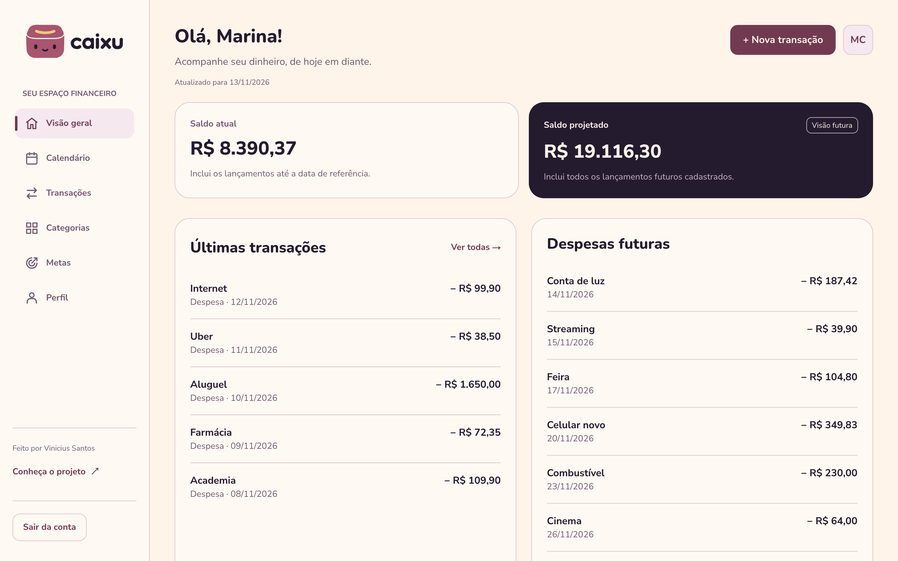
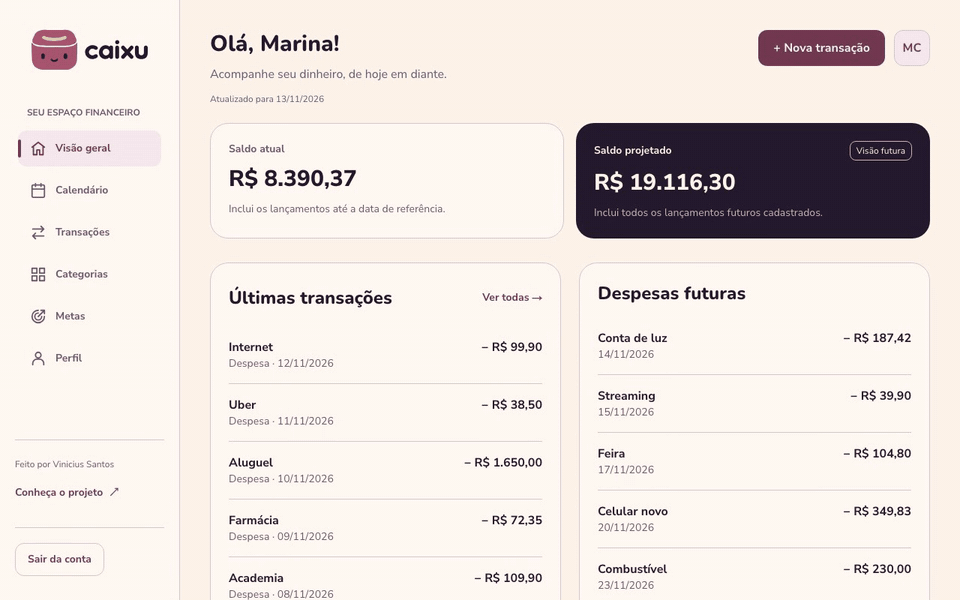
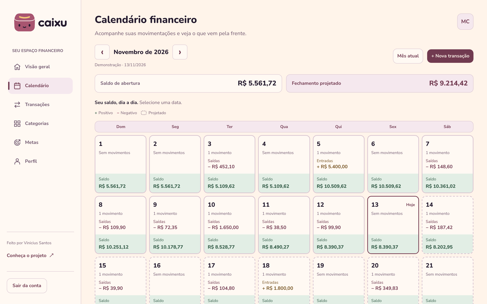
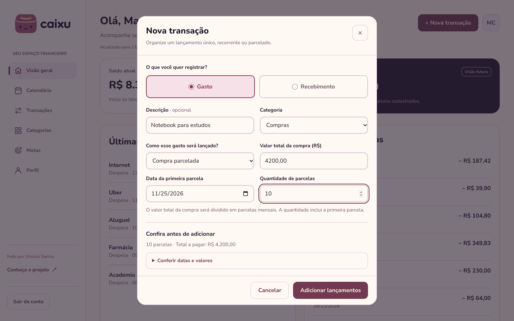
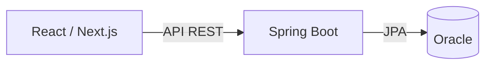

<h1 align="center">Caixu</h1>
<p align="center"><strong>Seu dinheiro em ordem. Seus planos mais próximos.</strong></p>

Aplicação fullstack de organização financeira pessoal. Registre receitas e despesas, acompanhe o saldo disponível e veja como os lançamentos futuros afetam seus planos.

O Caixu nasceu como projeto integrador da FIAP, reunindo Java, Spring Boot, Oracle e React. A interface usa Next.js, Tailwind CSS e uma identidade visual própria, com navegação adaptada para desktop e dispositivos móveis.

## Telas

<p align="center">
  
</p>

<p align="center">
  
</p>

| Calendário financeiro | Compra parcelada com prévia |
| --- | --- |
|  |  |

<p align="center">
  
  &nbsp;&nbsp;
  
</p>

<p align="center"><sub>Dados fictícios de demonstração. As imagens são geradas por <code>scripts/capturas</code>.</sub></p>

## O que você pode fazer

- **Organizar suas movimentações:** cadastrar, consultar, editar e excluir receitas e despesas, com categoria opcional.
- **Planejar no tempo:** registrar lançamentos únicos, recorrentes ou parcelados e excluir uma ocorrência ou a selecionada e as seguintes.
- **Acompanhar saldos:** consultar o saldo atual, a projeção futura e as datas de maior impacto no mês.
- **Explorar o calendário financeiro:** visualizar o saldo acumulado por dia e abrir os detalhes das movimentações.
- **Personalizar sua conta:** gerenciar perfil, saldo inicial e categorias de gastos e recebimentos.
- **Acessar sua área pessoal:** criar uma conta, entrar e sair de uma sessão autenticada.

Os lançamentos são manuais, sem integração bancária. <br> Metas, reserva financeira, investimentos e recuperação de senha permanecem como evolução futura; as telas de apresentação dessas áreas não representam funcionalidades concluídas.

## Tecnologias

| Camada | Tecnologias |
| --- | --- |
| Backend | Java 17, Spring Boot, Spring Web MVC, Spring Data JPA, Jakarta Validation |
| Frontend | React, Next.js App Router, TypeScript, Tailwind CSS |
| Persistência | Oracle Database, Hibernate/JPA |
| Ferramentas | Maven Wrapper, npm, Git |

## Arquitetura e decisões



O backend organiza a aplicação em Controller, Service e Repository. DTOs definem os dados de entrada e saída; as entidades `Usuario`, `Categoria` e `Transacao` representam a persistência.

- O saldo é calculado a partir do saldo inicial e das movimentações, evitando manter uma segunda informação de saldo que possa ficar desatualizada.
- Categorias são opcionais nos lançamentos. Quando utilizadas, precisam pertencer ao usuário e corresponder ao tipo da movimentação.
- Parcelas e recorrências possuem identificação de grupo e de ocorrência persistida no banco.
- A propriedade dos dados é validada no backend a partir da sessão autenticada.
- Senhas são armazenadas com hash PBKDF2 e salt individual. A autenticação usa cookie HttpOnly e proteção CSRF nas operações de escrita.

## Estrutura do repositório

```text
backend/             API Spring Boot, Maven Wrapper e testes Java
frontend/            Interface Next.js, assets e testes dos cálculos
sql/                 Scripts de criação e atualização do modelo Oracle
docs/planejamento/   Contrato, decisões e histórico acadêmico
```

## Executar localmente

### Pré-requisitos

- JDK 17 ou superior, compatível com o projeto.
- Node.js 24 e npm para executar o frontend e seus testes TypeScript.
- Um schema Oracle próprio, acessível pela aplicação e com permissão para criar as tabelas.

O repositório não fornece acesso a um banco compartilhado nem credenciais de demonstração. Crie sua conta pela página de cadastro após iniciar os serviços.

### 1. Preparar o banco

Em um schema novo, execute [sql/01_schema.sql](sql/01_schema.sql) como script no Oracle SQL Developer. O script cria as três entidades e suas restrições.

Na inicialização, o backend aplica a atualização aditiva de [02_transacoes_sequencias.sql](backend/src/main/resources/db/02_transacoes_sequencias.sql), que permite categoria opcional e adiciona os campos de parcelas e recorrências. Existe também uma [versão para execução manual](sql/02_transacoes_sequencias.sql).

Se as tabelas já existem, preserve os dados e utilize a atualização aditiva. O Hibernate está configurado com `ddl-auto=validate`; o script inicial não deve ser executado sobre tabelas existentes.

### 2. Iniciar a API

Na raiz do repositório:

```bash
cd backend
export ORACLE_JDBC_URL='jdbc:oracle:thin:@//SEU_HOST:1521/SEU_SERVICO'
export ORACLE_DB_USER='SEU_USUARIO'
export ORACLE_DB_PASSWORD='SUA_SENHA'
export TZ='America/Sao_Paulo'
./mvnw spring-boot:run
```

Substitua os exemplos pelas variáveis do seu ambiente. Você também pode configurá-las na execução da IDE. O arquivo [backend/.env.example](backend/.env.example) documenta os nomes; o Spring Boot não carrega arquivos `.env` automaticamente.

A API fica disponível em `http://localhost:8080/api`. A origem permitida por padrão é `http://localhost:3000`; para outra origem, configure `CAIXU_CORS_ORIGINS` no backend.

A criação automática de conta de desenvolvimento fica desabilitada por padrão. Para usar o app, prefira cadastrar sua própria conta pela interface.

### 3. Iniciar a interface

Em outro terminal, na raiz do repositório:

```bash
cd frontend
cp .env.example .env.local
npm install
npm run dev
```

Abra [localhost:3000](http://localhost:3000). O arquivo `.env.local` utiliza:

```dotenv
NEXT_PUBLIC_API_URL=http://localhost:8080/api
```

Essa variável contém somente o endereço público da API. Credenciais do banco pertencem exclusivamente ao ambiente do backend.

### 4. Usar o Caixu

Acesse `/cadastro`, crie sua conta e entre em `/login`. Cadastre suas movimentações e, se desejar, categorias. Os saldos e o calendário passam a refletir os dados dessa conta.

## Verificações

Testes unitários do backend:

```bash
cd backend
./mvnw test
```

Verificações do frontend, em outro terminal a partir da raiz:

```bash
cd frontend
npm run lint
npm test
npm run build
```

Os testes padrão do backend não exigem conexão Oracle. Para incluir o teste de contexto com banco, configure as variáveis Oracle e execute `./mvnw -Poracle test` na pasta `backend`.

O build do frontend valida a compilação, mas não substitui os testes de ponta a ponta com a API e o banco ativos. Para servir o build localmente, execute `npm start` na pasta `frontend` após `npm run build`.

## Documentação e evolução

O [índice de planejamento](docs/planejamento/README.md) reúne o contrato inicial, as decisões de modelagem e o inventário acadêmico. Esses registros preservam o histórico de construção; os códigos e as instruções deste README descrevem a execução atual.

A evolução prevista inclui recuperação de senha, metas e reserva financeira. O projeto mantém foco no controle manual de receitas e despesas.

## Autor e licença

Desenvolvido por [Vinicius Santos](https://github.com/santos-vinicius), com foco em desenvolvimento Fullstack Java / React e design de interfaces.

Distribuído sob a [licença MIT](LICENSE).
